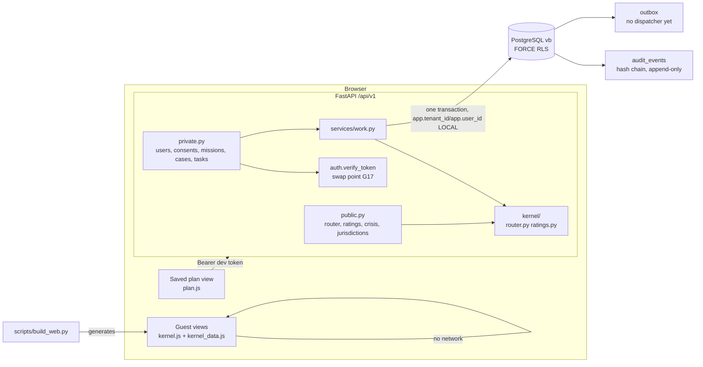

# Architecture (as built)

Modular monolith. The governing sentence: **agents orchestrate, gather and explain; they never decide.** Today no agent exists; every answer comes from deterministic kernels.



## Request: save a Mission Brief (Mode B)

```mermaid
sequenceDiagram
  participant W as Web (plan.js)
  participant A as API
  participant D as PostgreSQL (as vetbuddy_app)
  W->>A: POST /api/v1/missions (declared facts only)
  A->>A: verify token -> Principal (subject from token)
  A->>D: resolve_principal(tenant, subject)
  A->>D: BEGIN; set_config(app.tenant_id, app.user_id, LOCAL)
  A->>D: has_consent('plan_storage')?  (else 409, nothing stored)
  A->>A: kernel.route(facts, today) — deterministic
  A->>D: INSERT mission, case, lanes, tasks (RLS WITH CHECK incl. consent)
  A->>D: INSERT audit (chained by trigger), outbox MISSION_CREATED, CASE_CREATED
  A->>D: COMMIT
  A-->>W: Mission Brief (+ disclosure, disclaimer)
```

## Data ownership

| Data | Owner | Who may write |
|---|---|---|
| Identity mapping (`users`) | Trust & Identity | `resolve_principal` (definer) only |
| Consent | Privacy & Consent Guardian (SQL) | The user, via API; allowlist CHECK |
| Mission / case / lanes / tasks | Work OS | Owner, with live consent |
| Audit | Operations | Append via API; chain by trigger; nobody updates |
| Router rules & wording | `kernel/vocab.py` | Code review only |

## Privacy modes

- **A Guest:** browser-only, or `POST /mission-router/evaluate` (stateless). Proven to write nothing.
- **B Personal:** saved plans with `plan_storage` consent.
- **C Managed case:** refused by `CHECK (privacy_mode = 'B')`.
